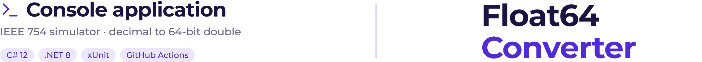
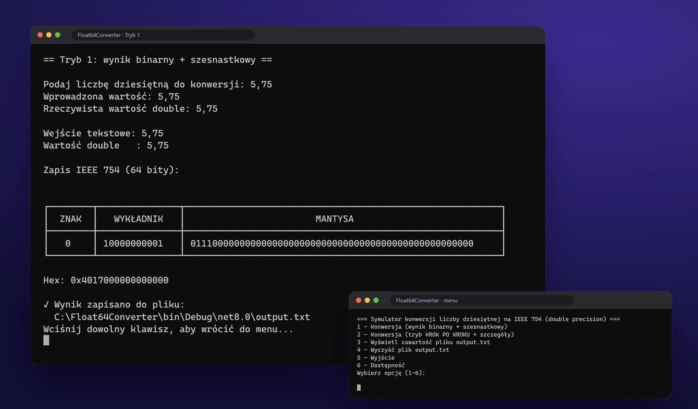
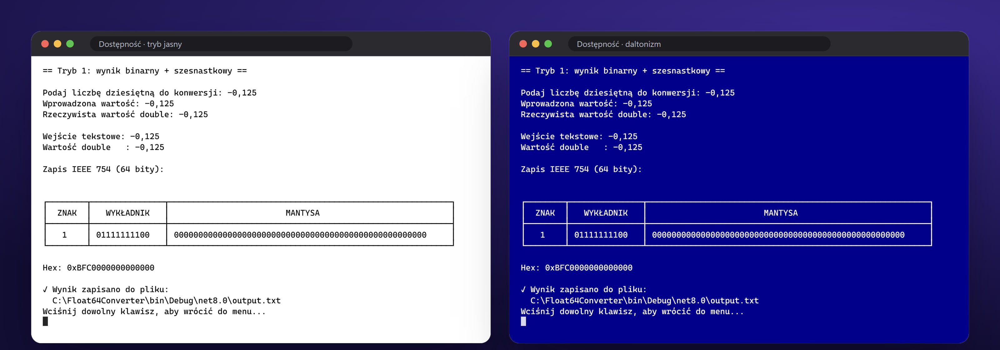
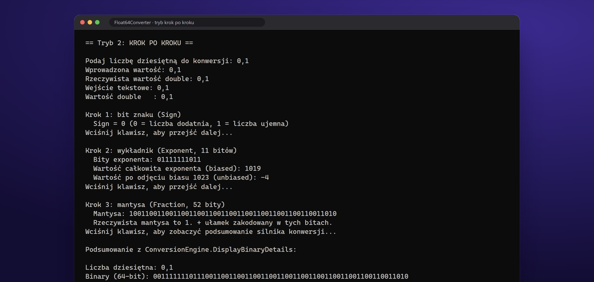

<p align="center">
  <picture>
    <source media="(prefers-color-scheme: dark)" srcset="docs/images/banner-dark.png">
    
  </picture>
</p>

<p align="center">
  
</p>

## About

**Float64Converter** is a console simulator that converts a decimal number into the 64-bit IEEE 754 floating-point
format (double precision), written in C#. The conversion is built from first principles: logic gates, a full adder, registers, an ALU and a small 64-bit CPU
model, with no library shortcut for the number format.

- **Hand-made conversion.** No `BitConverter`, no `Convert.ToString`, no `System.Math`: the decimal-to-binary
  conversion, the number parser (decimal and scientific notation such as `5,75`, `-0,125`, `1e3`) and the maths
  helpers (`Abs`, `Pow2`, `IsNaN`...) are written by hand in `core/utils/`.
- **Sign, exponent, mantissa.** The result is shown as the three bit fields (S / E / M), in binary and in hex, in a
  table.
- **Step-by-step mode.** A debug mode prints every stage of the conversion.
- **Verified by reconstruction.** `IEEE754Validator` rebuilds the number from the bits and compares it with the input.
- **Hardware model.** `AndGate`, `OrGate`, `XorGate`, `FullAdder`, `Register64bit`, `ALU64bit` and `CPU64bit`
  are separate classes in `core/`.
- **Accessibility.** Five colour profiles for the console: default, high contrast, inverted, colour-blind
  (blue / white) and light-sensitive (light text on dark).
- **Result log.** Each conversion is appended with a timestamp to `output.txt`, which the menu can show or clear.
- **Tested:** 28 xUnit tests (gates, ALU and CPU, parser, maths helpers, validator, conversion engine), run by a
  GitHub Actions workflow.

> **Status:** the user interface, the log and the code comments are in Polish; identifiers are in English.

## Team

The team:

| Member                | Role                                                              |
| --------------------- | ----------------------------------------------------------------- |
| Damian Tchorzewski    | team lead, integration and documentation                          |
| Mateusz von Schiller  | unit tests, validation and verification of correctness            |
| Mateusz Wołoszyk      | user interface, input and output parser                           |
| Joanna Wysokińska     | specification and design of the conversion algorithm (IEEE 754)   |
| Mateusz Zątek         | implementation of the conversion engine (main module)             |
| Bartłomiej Zygmunt    | not active                                                        |

## Tech stack

|          |                                                                                              |
| -------- | -------------------------------------------------------------------------------------------- |
| Stack    | C# 12, .NET 8 console application (`net8.0`, nullable reference types on)                    |
| Tests    | xUnit 2.6, Microsoft.NET.Test.Sdk, coverlet collector                                        |
| CI       | GitHub Actions: restore, build and test on `windows-latest`, test results uploaded as `.trx` |
| IDE      | Visual Studio 2022 (Community or higher)                                                     |

The interface texts and code comments are Polish; identifiers, commits and branches are in English.

## Screenshots

The output is real: `tools/projects/ieee754-conversion-simulator/make-transcripts.mjs` runs the program's own code with a fixed
input and `tools/readme-images` draws what it printed. The texts are Polish. Two of the five accessibility profiles
(light mode and colour-blind) on the conversion of `-0,125`:

<p align="center">
  
</p>

Step-by-step mode on `0,1` (a number a double cannot hold exactly): sign, exponent (biased and unbiased) and mantissa, one key press at a time:

<p align="center">
  
</p>

A record in `output.txt`:

```
[2025-12-02 14:30:15] TRYB 1
Wejście : 5.75
double  : 5,75
binary  : 0100000000010110000000000000000000000000000000000000000000000000
hex     : 0x4017000000000000
------------------------------------------------------------
```

## Quick start

```bash
git clone https://github.com/DamTchorzewski/ieee754-conversion-simulator.git
cd ieee754-conversion-simulator
dotnet run --project Float64Converter.csproj
```

Requirements: .NET SDK 8.0 or newer. In Visual Studio open `Float64Converter.sln` and press Ctrl + F5. Results are
written to `output.txt` next to the executable (`bin/Debug/net8.0/`).

## Scripts

| Command                                                                | What it does                                  |
| ---------------------------------------------------------------------- | --------------------------------------------- |
| `dotnet run --project Float64Converter.csproj`                         | start the console application                 |
| `dotnet build Float64Converter.csproj --configuration Release`         | build the application                         |
| `dotnet test Float64Converter.Tests/Float64Converter.Tests.csproj`     | run the unit tests (what CI runs)             |

## Configuration

None. The application has no environment variables, keys or settings files; the only file it writes is `output.txt`.

## Structure

```
Program.cs                    ★ entry point: the menu, the modes, the accessibility menu
core/ConversionEngine.cs      ★ the conversion and the display of the result
core/accessibility/           colour profiles for the console
core/components/              FullAdder
core/cpu/                     ALU64bit, CPU64bit, registers/Register64bit
core/gates/                   AndGate, OrGate, XorGate
core/utils/                   Float64ConverterUtils, IEEE754Validator, MathHelpers, NumberParser, TableFormatResult
Float64Converter.Tests/       xUnit tests, one file per module
.github/workflows/            dotnet-ci.yml: build and test
docs/                         documentation; docs/images/ holds the README images (generated)
```

## Branches and workflows

Shared standards from `reops/standards`: `main` ≤ `develop` ≤ a working branch `<type>/<topic>`, fast-forward
merges, Conventional Commits in English. The workflow `dotnet-ci.yml` builds and tests every push to `main` and
every pull request.

**Departures from the standards (and why):**

- **No "Open site" button and no phone strip:** a console program has no site and no mobile view; the images are
  terminal windows with real output, and the logo is a wordmark (the project has none).
- **No company branding in the footer:** the repository belongs to a team of authors.
- **No husky / commitlint / lint-staged:** a .NET project without a Node toolchain; the commit style is kept by hand.
- **CI on `main` and `codex/*` only:** the workflow does not run on `develop`.
- **Interface texts and code comments in Polish:** the users of the program speak Polish.
- **The C# project keeps its name:** the repository is called `ieee754-conversion-simulator` (a name to find it by), while
  the project, the solution and the namespace stay `Float64Converter`.

## Documentation

| Document                                   | Covers                                                   |
| ------------------------------------------ | -------------------------------------------------------- |
| [docs/repository.md](docs/repository.md)   | GitHub description and topics                          |

The README images (`docs/images/`) are regenerated with `tools/readme-images` (profile `ieee754-conversion-simulator`), after
`make-transcripts.mjs` has captured the output; the working shots go to `.scratch/`.

---

Author: [Damian Tchorzewski](https://github.com/DamTchorzewski)
